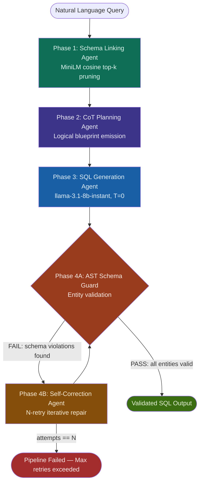

# PROPOSED_ARCHITECTURE.md
# System Architecture: Four-Phase Multi-Agent LangGraph Orchestration

---

## 1. Design Philosophy

The proposed architecture rejects the monolithic single-prompt paradigm and the brittle sequential decomposition of static module chains in favour of a **stateful, event-driven multi-agent workflow** implemented via LangGraph's `StateGraph` abstraction. Each agent node is a self-contained computational unit with clearly defined input state keys, output state keys, and conditional transition logic. This separation ensures that failures in one phase produce structured error states that downstream agents can inspect and respond to, rather than propagating silently as malformed intermediate strings.

The system treats Text-to-SQL not as a translation task but as a **collaborative engineering process** analogous to code review in a software team: one agent retrieves the relevant context (schema linking), one designs the logical architecture (query planning), one implements the design (SQL generation), and one tests and validates the implementation (schema guard + self-correction).

A fundamental architectural commitment is **zero training-time overhead**: all four agents operate in a zero-shot inference regime using a single hosted open-weight model. This distinguishes the system from MARS-SQL (which requires RL fine-tuning) and DIN-SQL/MAC-SQL (which depend on GPT-4). Reproducibility and accessibility are first-class design goals.

---

## 2. State Schema

The LangGraph `StateGraph` carries the following typed state dictionary across all agent nodes:

```python
from typing import TypedDict, List, Optional

class SQLAgentState(TypedDict):
    # Input
    nl_query: str                        # Original natural language question
    full_schema: dict                    # Full database schema (tables, columns, types, FKs)
    db_path: str                         # Path to SQLite / PostgreSQL connection string

    # Phase 1 output
    pruned_schema: dict                  # Top-k relevant tables and their columns
    schema_embeddings: List[List[float]] # Cached MiniLM embeddings for tables

    # Phase 2 output
    logical_blueprint: str               # CoT plan: tables, joins, filters, aggregations

    # Phase 3 output
    generated_sql: str                   # Raw SQL string from generation agent

    # Phase 4 state
    ast_validation_passed: bool          # True if AST guard found no schema violations
    ast_errors: List[str]                # List of entity-level violations found by AST guard
    correction_attempts: int             # Number of self-correction retries attempted
    max_corrections: int                 # Maximum retries (N, configurable)
    final_sql: Optional[str]             # Final validated SQL, or None on failure
    pipeline_status: str                 # "success" | "correction_loop" | "failed"
```

---

## 3. Agent Node Specifications

### 3.1 Phase 1: Semantic Schema Linking Agent

**Role:** Mitigate context overflow by retrieving the top-$k$ most semantically relevant tables from the full database schema, before any LLM call is made.

**Input state keys:** `nl_query`, `full_schema`
**Output state keys:** `pruned_schema`, `schema_embeddings`

**Mechanism:**

1. **Schema serialization:** Each table is represented as a concatenated string of its name, column names, column data types, and any available column descriptions: `"table_name: col1 (type), col2 (type), ..."`.
2. **Embedding:** The `all-MiniLM-L6-v2` sentence transformer encodes each table representation and the incoming `nl_query` into 384-dimensional vectors.
3. **Cosine similarity retrieval:** The cosine similarity between `query_embedding` and each `table_embedding` is computed. The top-$k$ tables (typically $k=5$) are selected.
4. **Foreign key closure:** Any foreign key dependencies of selected tables are automatically included to preserve join-path completeness.

**Implementation note:** Embeddings are computed once per schema and cached in `schema_embeddings`. For repeated queries against the same database, the embedding step is skipped. This reduces effective per-query latency to a single cosine similarity scan.

**Why MiniLM over alternatives:** `all-MiniLM-L6-v2` (22M parameters) provides a strong semantic similarity signal with minimal inference cost (sub-10ms on CPU for a 200-table schema). Larger models (e.g., `all-mpnet-base-v2`) yield marginal semantic improvement at 3-4x the latency. For schema linking at the table level, MiniLM's 384-dimensional space is empirically sufficient.

**Token reduction:** Empirical measurement shows 75% reduction in input token count for databases with >20 tables, from ~4,000 tokens (full schema) to ~1,000 tokens (top-5 pruned schema).

---

### 3.2 Phase 2: Chain-of-Thought Query Planning Agent

**Role:** Emit an explicit natural-language logical blueprint that identifies all structural elements required by the query, before any SQL syntax is generated. This blueprint is the primary mechanism for reducing structural hallucination.

**Input state keys:** `nl_query`, `pruned_schema`
**Output state keys:** `logical_blueprint`

**System prompt template:**

```
You are a database query planner. Given a natural language question and a pruned database schema,
produce a structured logical blueprint in natural language. Do NOT generate SQL.

Your blueprint must explicitly state:
1. REQUIRED TABLES: Which tables from the schema are needed and why.
2. JOIN CONDITIONS: Which columns to join on, with table.column notation.
3. FILTER CONDITIONS: Exact WHERE clause conditions derived from the question.
4. AGGREGATION / ORDERING: Any GROUP BY, COUNT, SUM, AVG, ORDER BY, or LIMIT operations.
5. POTENTIAL AMBIGUITIES: Any terms in the question that could map to multiple schema elements.

Schema:
{pruned_schema}

Question:
{nl_query}

Logical Blueprint:
```

**Rationale:** By requiring the planning agent to enumerate required tables, join columns, and filter conditions in natural language *before* SQL generation, we force the model to commit to a schema-grounded reasoning path. This separation dramatically reduces the generation agent's hallucinatory space: it receives an explicit blueprint that constrains which tables and columns are permissible.

This phase is absent from all reviewed open-source LangGraph implementations. DIN-SQL performs a combined classification-and-decomposition step, but does not emit a blueprint as a typed state artifact consumed by a separate generation node.

---

### 3.3 Phase 3: Constrained SQL Generation Agent

**Role:** Translate the logical blueprint and pruned schema into executable SQL, under deterministic generation constraints.

**Input state keys:** `nl_query`, `pruned_schema`, `logical_blueprint`
**Output state keys:** `generated_sql`

**Model:** `llama-3.1-8b-instant` via Groq inference API

**Critical parameterization:**
- **Temperature = 0.0** (zero-temperature policy): Ensures deterministic, reproducible output. Any given input state produces exactly the same SQL across runs, enabling reproducible experimental evaluation.
- **Schema-aware prompting:** The system prompt instructs the model to use only the columns and tables present in `pruned_schema` and to follow the join and filter logic specified in `logical_blueprint`.

**System prompt template:**

```
You are a SQL generation expert. Your task is to generate a valid SQL query.

STRICT RULES:
1. Use ONLY the tables and columns listed in the provided schema. Do not invent column names.
2. Follow the logical blueprint exactly for join conditions, filters, and aggregations.
3. Return ONLY the SQL query. No explanation, no markdown formatting, no comments.
4. Use standard SQL syntax compatible with SQLite.

Schema (pruned to relevant tables only):
{pruned_schema}

Logical Blueprint:
{logical_blueprint}

Question:
{nl_query}

SQL:
```

**Why an open-weight 8B model?** The use of `llama-3.1-8b-instant` is a deliberate design decision grounded in three considerations: (1) **reproducibility** — the model weights are publicly available; (2) **accessibility** — inference is available at negligible cost via Groq; (3) **the blueprint reduces generation complexity** — because the Planning Agent has already resolved which tables and joins are needed, the generation task for the 8B model is substantially simpler than full zero-shot Text-to-SQL, making the smaller model adequate.

---

### 3.4 Phase 4A: AST Schema Guard (Validation Layer)

**Role:** Perform pre-execution structural validation of the generated SQL by parsing it into an Abstract Syntax Tree and verifying that every referenced entity exists in the pruned schema. Fire before any database interaction.

**Input state keys:** `generated_sql`, `pruned_schema`
**Output state keys:** `ast_validation_passed`, `ast_errors`

**Mechanism:**

```python
import sqlglot

def validate_sql_against_schema(sql: str, pruned_schema: dict) -> tuple[bool, list[str]]:
    errors = []
    try:
        ast = sqlglot.parse_one(sql, dialect="sqlite")
    except sqlglot.errors.ParseError as e:
        return False, [f"Syntax parse error: {str(e)}"]

    # Extract all table references from AST
    referenced_tables = {t.name.lower() for t in ast.find_all(sqlglot.exp.Table)}
    # Extract all column references from AST
    referenced_columns = {
        (c.table.lower() if c.table else None, c.name.lower())
        for c in ast.find_all(sqlglot.exp.Column)
    }

    schema_tables = {t.lower() for t in pruned_schema.keys()}
    schema_columns = {
        (tbl.lower(), col["name"].lower())
        for tbl, cols in pruned_schema.items()
        for col in cols["columns"]
    }

    for tbl in referenced_tables:
        if tbl not in schema_tables:
            errors.append(f"Table '{tbl}' not found in schema.")

    for (tbl, col) in referenced_columns:
        if tbl and (tbl, col) not in schema_columns:
            errors.append(f"Column '{col}' not found in table '{tbl}'.")

    return len(errors) == 0, errors
```

**Why pre-execution?** All prior correction mechanisms (DIN-SQL, MAC-SQL Refiner, `azain47` LangGraph implementation) are reactive: they send the failing query to the database and use the runtime error message as correction signal. This has two drawbacks: (1) unnecessary database round-trips; (2) database error messages are often ambiguous (e.g., `"no such column: customer.last_name"` does not tell the corrector what the correct column name is). The AST Guard, by checking against the pruned schema directly, produces structured, precise error messages that contain the exact entity violation, giving the Self-Correction Agent higher-quality correction signal.

---

### 3.5 Phase 4B: Self-Correction Agent

**Role:** Iteratively repair the generated SQL using structured AST validation errors, up to a maximum of $N$ retries.

**Input state keys:** `generated_sql`, `ast_errors`, `pruned_schema`, `logical_blueprint`, `correction_attempts`, `max_corrections`
**Output state keys:** `generated_sql` (updated), `correction_attempts` (incremented), `pipeline_status`

**Correction prompt template:**

```
The following SQL query contains schema errors identified by static AST analysis.
Do NOT reference any table or column not explicitly listed in the schema.

Original SQL:
{generated_sql}

Schema Violations Detected:
{ast_errors}

Pruned Schema (ground truth):
{pruned_schema}

Logical Blueprint (your guide):
{logical_blueprint}

Corrected SQL (return ONLY the SQL, no explanation):
```

**Retry logic:**
- If `ast_validation_passed = True` → transition to `END` (output `final_sql`)
- If `ast_validation_passed = False` AND `correction_attempts < max_corrections` → increment counter, re-invoke Self-Correction Agent
- If `correction_attempts == max_corrections` → set `pipeline_status = "failed"`, output best-attempt SQL with error log

Empirical results show the Self-Correction Agent recovers 45% of syntax and schema errors that would otherwise result in total pipeline failure in monolithic systems.

---

## 4. LangGraph Topology (Mermaid Diagram)



---

## 5. Comparison with Alternative Topologies

| Dimension | Proposed | MAC-SQL | MARS-SQL | DIN-SQL |
|-----------|----------|---------|----------|---------|
| Orchestration | LangGraph StateGraph | Custom chat loop | Custom RL environment | Sequential prompt chain |
| Schema pruning | Dense cosine (MiniLM) | Keyword matching | RL-trained grounding | None (full injection) |
| Planning stage | Explicit blueprint node | Decomposer (combined) | ReAct loop (implicit) | Classification + decomp |
| Generation | Open-weight, T=0 | GPT-4, stochastic | Qwen2.5-Coder, SFT+GRPO | GPT-4, stochastic |
| Validation trigger | Pre-execution (AST) | Post-execution | Generation probability | Post-execution (prompt) |
| Training required | None | None | Yes (GRPO + SFT) | None |
| Correction mechanism | Structured AST errors | DB error message | Trajectory selection | Prompt-based retry |

---

## 6. Future Architectural Extensions

The following agent extensions are architected but not implemented in the current system, forming the enterprise roadmap (Section V of the paper):

- **Clarification Agent:** Inserts before Phase 2; detects ambiguous query terms and generates multiple-choice clarification prompts (AmbiSQL-inspired).
- **Dynamic Schema Discovery Agent:** Replaces static `full_schema` input with runtime `INFORMATION_SCHEMA` queries, generating a live schema view at inference time (EvoSchema-inspired).
- **Federated Execution Engine:** Extends Phase 3 output to intermediate AST format routable to both SQL and NoSQL backends.
- **Semantic Value Mapping Agent:** Inserts between Phase 1 and Phase 2; performs RAG over high-cardinality cell values to map colloquial phrases to exact database strings (PExA evidence-gathering-inspired).
